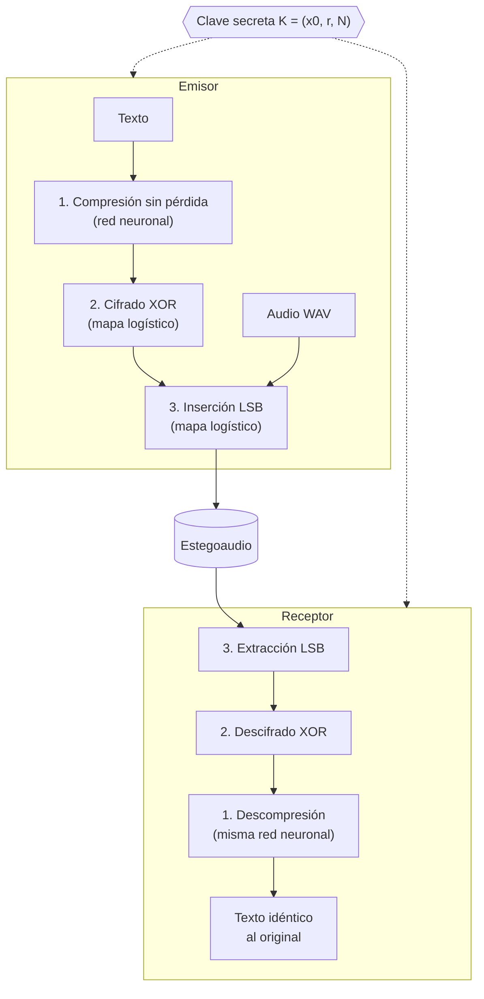
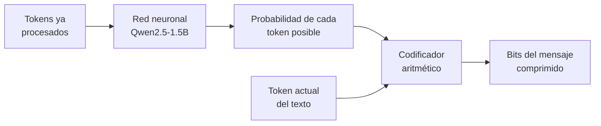
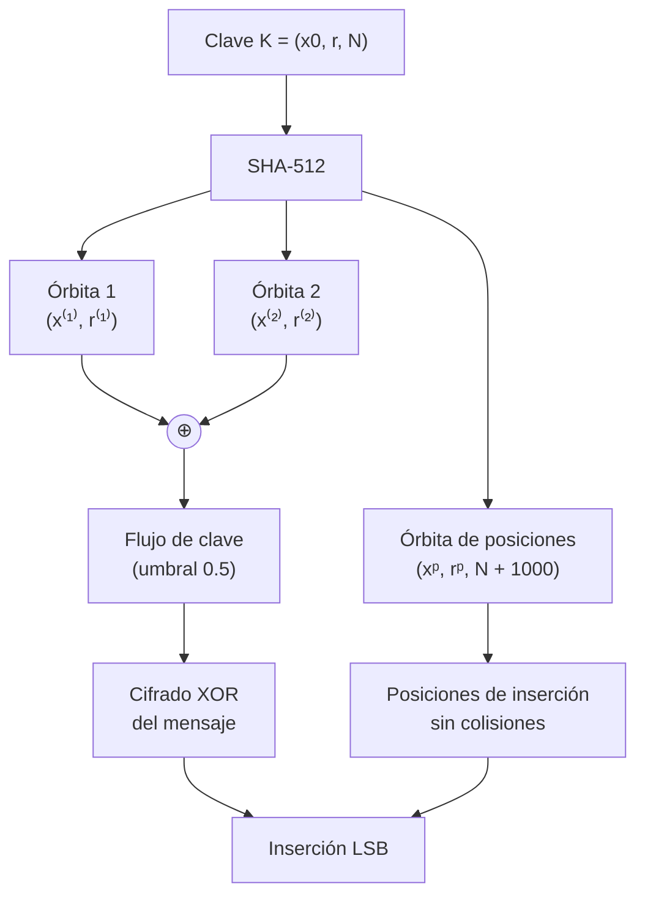
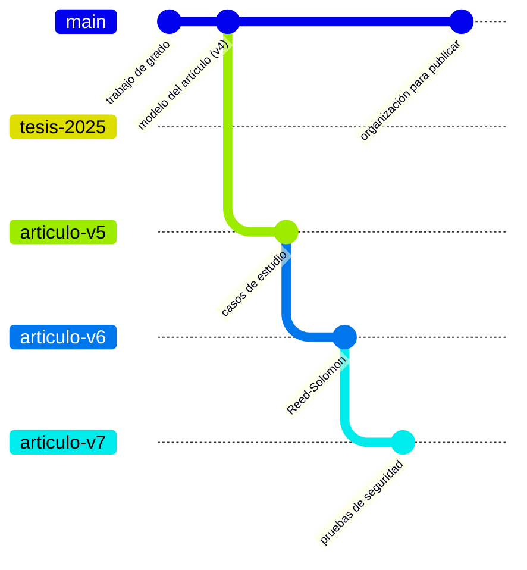

# Modelo criptoesteganográfico sobre archivos de audio basado en redes neuronales y atractores caóticos

[](LICENSE)


Código del modelo presentado en el artículo homónimo, en revisión en la Revista TecnoLógicas. El modelo se deriva del trabajo de grado
*Criptosistema esteganográfico de audio basado en atractores caóticos y compresión de textos por medio de redes neuronales*
(Universidad Distrital Francisco José de Caldas, Ingeniería de Sistemas).

**Autores:** Juan Felipe Rodríguez-Galindo, Mateo Bohórquez-Rodríguez, Luz Deicy Alvarado-Nieto e Isabel Amaya-Barrera.

---

## Contenido

- [Cómo funciona](#cómo-funciona)
- [Resultados principales](#resultados-principales)
- [Instalación](#instalación)
- [Uso rápido](#uso-rápido)
- [Reproducción del artículo](#reproducción-del-artículo)
- [Estructura del repositorio](#estructura-del-repositorio)
- [Versiones del artículo](#versiones-del-artículo)
- [Datos y licencias](#datos-y-licencias)
- [Cómo citar](#cómo-citar)

## Cómo funciona

El emisor oculta un mensaje de texto en un archivo de audio WAV en tres etapas y el receptor, que conoce la clave
secreta K = (x<sub>0</sub>, r, N), aplica las etapas en orden inverso y recupera el mensaje de forma exacta, byte a byte.



### 1. Compresión sin pérdida con una red neuronal

La red neuronal Qwen2.5-1.5B, un modelo de lenguaje de tipo *Transformer*, estima en cada paso la probabilidad del siguiente token
del texto. Un codificador aritmético asigna a cada token un número de bits cercano a −log<sub>2</sub> p, de modo que los tokens que la
red predice bien cuestan muy pocos bits. El receptor ejecuta la misma red, reproduce las mismas probabilidades y recupera cada token
sin pérdida ([`src/compresion/llm_aritmetico.py`](src/compresion/llm_aritmetico.py)).



El token actual se agrega luego a los tokens procesados y el proceso se repite hasta el final del texto.

### 2 y 3. Cifrado e inserción con el mapa logístico

Los parámetros de tres órbitas del mapa logístico x<sub>n+1</sub> = r·x<sub>n</sub>·(1 − x<sub>n</sub>) se derivan de la clave con
SHA-512, de modo que cualquier cambio en x<sub>0</sub>, r o N produce órbitas independientes. Dos órbitas forman el flujo de clave
del cifrado XOR y la tercera elige las muestras del audio cuyo bit menos significativo se reemplaza
([`src/utils/caos.py`](src/utils/caos.py), [`src/encriptado/`](src/encriptado), [`src/esteganografiado/`](src/esteganografiado)).



> **Requisito:** emisor y receptor deben ejecutar la red con la misma configuración (pesos, punto flotante de 32 bits y tipo de
> dispositivo), igual que deben compartir la clave. La red es pública: la seguridad reside solo en K.

## Resultados principales

Caso de estudio: poema *Nocturno* de José Asunción Silva (928 bytes) oculto en un audio WAV estéreo de 16 bits a 44.1 kHz.

| Aspecto | Resultado |
|---|---|
| Compresión | 928 → 173 bytes (18.6 %, 1.54 bits por carácter); zlib: 535 bytes |
| Mensaje oculto | 1400 bits en 25 143 552 muestras (0.006 %) |
| Imperceptibilidad | PSNR de 135.89 dB, MSE de 2.76×10⁻⁵ |
| Recuperación | Exacta (resumen SHA-256 idéntico), también en un equipo distinto al del emisor |
| Espacio de clave | 2<sup>112.91</sup> claves válidas y distinguibles entre sí |
| Sensibilidad | Un cambio de 10⁻¹⁵ en x<sub>0</sub> altera cerca del 50 % de los bits extraídos |

## Instalación

```bash
git clone https://github.com/Juferoga/se-tesis.git
cd se-tesis
python3 -m venv .venv && source .venv/bin/activate
pip install -r requirements.txt
```

La primera ejecución descarga los pesos de la red (`Qwen/Qwen2.5-1.5B`, unos 3 GB) desde Hugging Face.

## Uso rápido

La demostración ejecuta el emisor y el receptor en procesos separados: el receptor solo recibe el estegoaudio y la clave, y
verifica que el texto recuperado sea idéntico al original.

```bash
./demo_recuperacion.sh            # con pausas, para presentar
./demo_recuperacion.sh --seguido  # sin pausas
```

## Reproducción del artículo

| Resultado | Comando |
|---|---|
| Sección 3: métricas, ataques y figuras | `./scripts/seccion3_neuronal.sh` |
| Espacio de clave (tablas 7 y 8) | `python -m scripts.espacio_clave` |
| Resolución efectiva de la clave | `python -m scripts.resolucion_clave` |
| Compresión y recuperación del texto | `python -I scripts/prueba_llm_aritmetico.py` |
| Casos de estudio adicionales (4 textos × 4 audios) | `scripts/casos_estudio_colab.py` en Google Colab con GPU; resultados en `outputs/revision_neuronal/casos/` |

Los resultados se guardan en [`outputs/revision_neuronal/`](outputs/revision_neuronal).

## Estructura del repositorio

```text
.
├── src/
│   ├── compresion/llm_aritmetico.py      # compresión sin pérdida con la red neuronal
│   ├── encriptado/                       # cifrado y descifrado XOR
│   ├── esteganografiado/                 # inserción y extracción LSB
│   └── utils/caos.py                     # mapa logístico y derivación de la clave
├── scripts/                              # experimentos del artículo
├── data/                                 # texto, audio portador y estegoaudio
├── outputs/revision_neuronal/            # resultados y figuras de la sección 3
└── demo_recuperacion.sh                  # demostración emisor-receptor
```

## Versiones del artículo



| Rama | Contenido |
|---|---|
| `main` | Modelo del artículo |
| `articulo-v5` | Casos de estudio adicionales (también incluidos en `main`) |
| `articulo-v6` | Robustez con código Reed-Solomon y repetición de bits |
| `articulo-v7` | Estegoanálisis, pruebas NIST SP 800-22 y ataques de procesamiento de señal |
| `tesis-2025` | Versión completa del trabajo de grado, incluida la compresión con LLMLingua |

## Datos y licencias

Los textos de los casos de estudio adicionales son de dominio público (Proyecto Gutenberg) y los audios se distribuyen con la biblioteca librosa con licencias libres; el detalle está en `outputs/revision_neuronal/casos/casos.json`.


- **Texto:** *Nocturno (Oh dulce niña pálida)*, José Asunción Silva, dominio público.
- **Audio:** «Let it go», Rewob (ft. debbizo), [ccmixter.org/files/rewob/70685](https://ccmixter.org/files/rewob/70685),
  Creative Commons Attribution-NonCommercial 4.0.
- **Código:** GNU General Public License v3.0 (ver [`LICENSE`](LICENSE)).

## Cómo citar

Si usa este código, cítelo con los datos de [`CITATION.cff`](CITATION.cff) (botón *Cite this repository* de GitHub). La versión del artículo está archivada en Zenodo con un DOI permanente.
